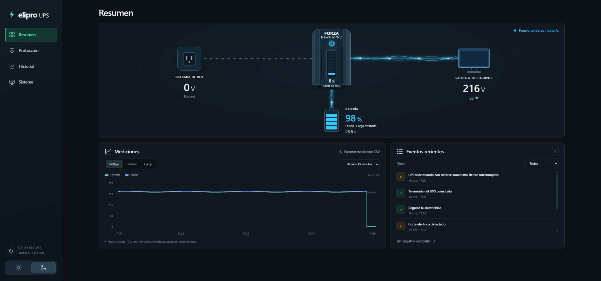
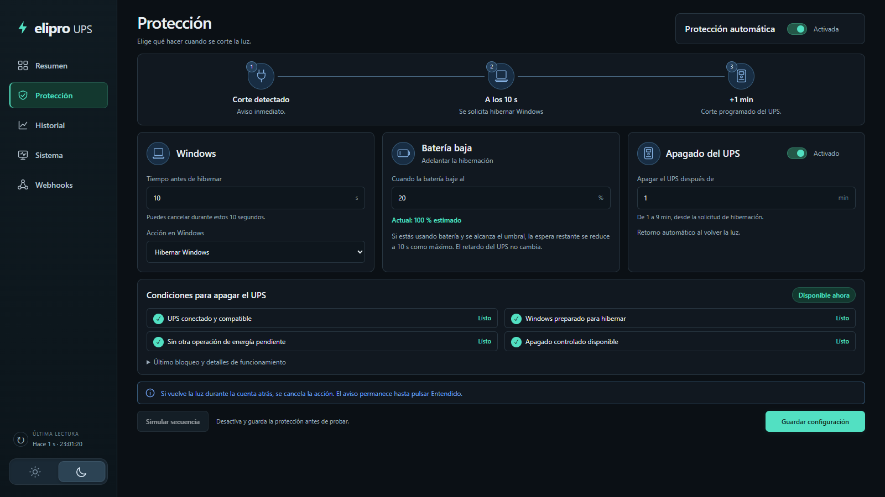
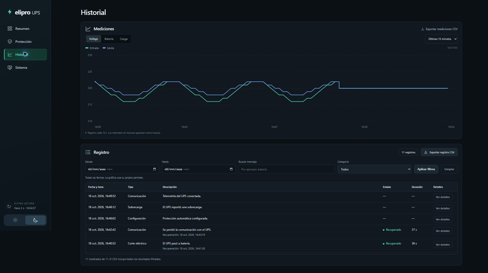
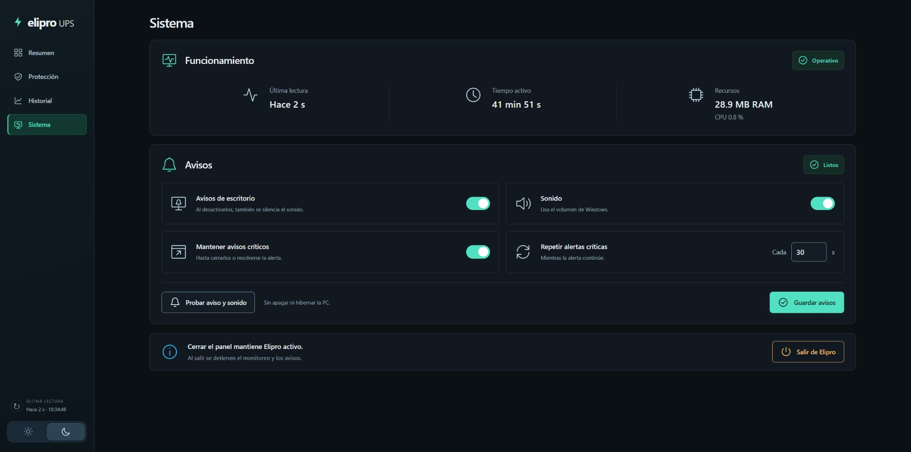
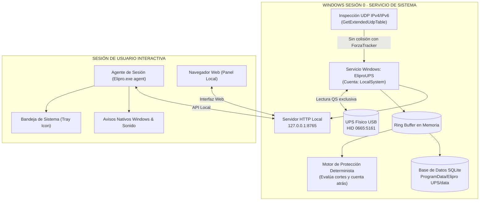

<div align="center">

  

  # Elipro UPS

  <p align="center">
    <strong>Monitor local para Windows con panel web, avisos de escritorio nativos, telemetría SQLite y reglas deterministas de protección o hibernación para UPS Forza.</strong>
  </p>

  <p align="center">
    <a href="https://github.com/eliseovt/elipro-ups/actions/workflows/windows-installer.yml"></a>
    
    
    
    
    
  </p>

  <p align="center">
    <a href="#visión-general"><b>Visión general</b></a> •
    <a href="#funciones"><b>Funciones</b></a> •
    <a href="#arquitectura-del-sistema"><b>Arquitectura</b></a> •
    <a href="#instalador-de-windows-x64"><b>Instalador x64</b></a> •
    <a href="#ejecutar-desde-el-código"><b>Uso desde código</b></a> •
    <a href="#lecturas-y-límites-del-hardware"><b>Límites de hardware</b></a> •
    <a href="#protección-automática"><b>Protección eléctrica</b></a> •
    <a href="#historial-y-funcionamiento"><b>Historial & Confiabilidad</b></a>
  </p>

</div>

---

<p align="center">
  
</p>

> [!IMPORTANT]
> **El apagado automático está desactivado por defecto.**<br>
> Windows debe permanecer despierto para vigilar el UPS. El instalador registra el servicio con el bloqueo `--dry-run`: las acciones reales de energía están bloqueadas, incluso si se activa una regla en el panel. La capacidad de ejecutar acciones requiere una modificación administrativa explícita del registro del servicio; es independiente de activar una regla.

> [!NOTE]
> **Proyecto independiente y privacidad local:**<br>
> Elipro es un proyecto independiente en desarrollo. No es software oficial de Forza ni tiene certificación del fabricante. La compatibilidad con otros modelos o revisiones de firmware no está comprobada. No requiere cuentas ni servicios de nube para funcionar. El servidor escucha únicamente en `127.0.0.1`; no está diseñado para exponerlo a una red.

---

## 📑 Tabla de contenidos

1. [Visión general](#visión-general)
2. [Funciones](#funciones)
3. [Arquitectura del sistema](#arquitectura-del-sistema)
4. [Instalador de Windows x64](#instalador-de-windows-x64)
   - [GitHub Actions (CI/CD)](#github-actions)
   - [Firma digital opcional](#firma-digital-opcional)
   - [Compilar localmente](#compilar-localmente)
5. [Ejecutar desde el código](#ejecutar-desde-el-código)
6. [Lecturas y límites del hardware](#lecturas-y-límites-del-hardware)
   - [Estimación derivada de batería](#estimación-derivada-de-batería)
   - [Diagnóstico explícito de batería](#diagnóstico-explícito-de-batería)
7. [Protección automática](#protección-automática)
   - [Apagado de la salida del UPS](#apagado-de-la-salida-del-ups)
   - [Secuencia de hibernación comprobada](#secuencia-de-hibernación-comprobada)
8. [Historial y funcionamiento](#historial-y-funcionamiento)
   - [Registro unificado y filtrado](#registro-unificado-y-filtrado)
   - [Confiabilidad y ring buffer](#confiabilidad-y-ring-buffer)
9. [Desarrollo y pruebas](#desarrollo-y-pruebas)
10. [Publicación y datos locales](#publicación-y-datos-locales)
11. [Referencias técnicas](#referencias-técnicas)

---

## <a id="visión-general"></a>🧭 Visión general

Elipro UPS es un monitor de energía para Windows diseñado para operar con el **Forza NT-2402PRO** mediante su lector USB por consultas de estado.

El corte de la salida del UPS es una capacidad separada, bloqueada hasta validar físicamente la unidad; el sondeo normal no envía controles ni inicia descargas.

> [!NOTE]
> **Alcance de la vigilancia continua:**<br>
> La vigilancia continua de energía, la persistencia en SQLite y la evaluación de las reglas de protección sin una sesión de usuario abierta corresponden **exclusivamente al servicio instalado de Windows (`EliproUPS` ejecutándose en Sesión 0 bajo la cuenta `LocalSystem`)**. La ejecución interactiva desde la consola (`python -m ups_monitor`) o mediante el script `Start-Elipro.ps1` **depende de la sesión de usuario** en la que se inició: al cerrar esa sesión, el monitor se detiene. Bloquear la sesión o desconectar una sesión de Escritorio remoto no equivale a cerrarla; la ejecución interactiva no ofrece la cobertura del servicio antes de iniciar sesión o tras cerrarla.

---

## <a id="funciones"></a>✨ Funciones

### Interfaz y secciones del panel
* **Cinco secciones especializadas:** **Resumen**, **Protección**, **Historial**, **Sistema** y **Webhooks**; temas claro y oscuro con selector sol/luna.
* **Protección compacta (0.9.20):** Tres columnas en el orden **Windows → Batería baja → Apagado del UPS**, con interruptores alineados, tiempos independientes y las cuatro condiciones de bloqueo siempre visibles. La secuencia, los ajustes y **Guardar configuración** caben en una pantalla en el estado normal, comprobado a 1366 × 768, 1600 × 900 y 1920 × 1080; en móvil se apilan. Los motivos activos permanecen visibles, mientras las notas y el último bloqueo histórico se consultan en un desplegable. La verificación está registrada en [docs/production-validation.md](docs/production-validation.md).
* **Resumen compacto y fiel al hardware:** Permite consultar el diagrama de energía, las mediciones y los eventos recientes en una sola vista de escritorio (1920 × 1080).
  * La ilustración del UPS muestra **FORZA** y el modelo en el frontal, **sin visor LCD** (fiel al dispositivo físico); su botón de encendido refleja el estado del suministro.
  * **Conductos de luz:** Emplean color **turquesa** en la entrada de red y **azul** en batería y salida, con pulsos solo cuando las lecturas recientes confirman energía hacia los equipos.
  * La rama de batería permanece neutra con suministro de red: la vista no infiere que esté cargando ni muestra flujo con datos antiguos, sin confirmar, una falla o salida sin energía.
  * Se adapta en altura para mostrar el diagrama y las dos tarjetas inferiores en escritorios amplios; móviles y ventanas bajas permiten desplazamiento fluido.
  * **Accesibilidad:** Detección nativa de `prefers-reduced-motion` para desactivar las animaciones de flujo conservando colores y datos estáticos.

<div align="center">
  <table>
    <tr>
      <td width="50%">
        
        <p align="center"><b>1 · Resumen</b><br><em>Diagrama compacto con conductos de luz (turquesa/azul), telemetría en vivo y eventos recientes</em></p>
      </td>
      <td width="50%">
        
        <p align="center"><b>2 · Protección</b><br><em>Windows, batería baja y UPS: ajustes independientes, cuatro condiciones visibles y avisos persistentes</em></p>
      </td>
    </tr>
    <tr>
      <td width="50%">
        
        <p align="center"><b>3 · Historial</b><br><em>Gráfica temporal de mediciones y tabla única «Registro» con filtros multicriterio y exportación CSV</em></p>
      </td>
      <td width="50%">
        
        <p align="center"><b>4 · Sistema</b><br><em>Salud operativa, consumo de recursos, configuración de avisos de escritorio/sonido y salida limpia</em></p>
      </td>
    </tr>
  </table>
</div>

Las capturas muestran una configuración de ejemplo; la protección automática está desactivada por defecto.

### Telemetría, avisos y notificaciones

* **Diseño de avisos (0.9.22):** Las ventanas de escritorio incorporan el logo de Elipro, colores coherentes con el panel, títulos y contador diferenciados, y **Cancelar protección** como acción principal durante una cuenta vigente. **Sistema → Avisos → Tema de las notificaciones** permite elegir **Automático**, **Claro** u **Oscuro**; Automático sigue el tema de Windows. La preferencia se guarda y también llega al agente de sesión del servicio. El [plan de implementación y verificación](docs/notification-redesign-plan.md) documenta el alcance y la entrega manual.
* **Prioridad de avisos (0.9.21):** Una cuenta regresiva real se muestra antes que las alarmas críticas; estas tienen prioridad sobre cortes y revisiones pendientes. Una alerta más urgente sustituye la ventana visible conservando los demás incidentes. Windows muestra el contador y permite **Cancelar protección** únicamente para la cuenta vigente, con confirmación del monitor. Los datos caducados deshabilitan ese botón; las actualizaciones del contador no repiten el sonido.
* **Telemetría continua:** Lectura de alimentación de red/batería, voltajes de entrada y salida, frecuencia, carga del UPS, voltaje de batería y señales de batería baja o falla.
* **Ventana modal global:** Los avisos de condiciones activas se cierran automáticamente cuando el monitor confirma su recuperación. Los avisos de recuperación son temporales y los incidentes se conservan en el historial, sin marcarlos como leídos automáticamente. **Entendido** permite reconocer un aviso activo; las cuentas atrás reales o simuladas mantienen **Cancelar protección** y reconocer un aviso no cancela la actuación. Los resultados que requieren revisión siguen visibles hasta confirmarlos.
* **Avisos nativos y System Tray:** Notificaciones de Windows, sonido e icono de bandeja aunque se cierre el navegador.
* **Retención durante bloqueo:** Avisos eléctricos retenidos durante bloqueo o desconexión de sesión, con acuse de aceptación nativa y recuperación del contexto al reanudar.
* **Resultados históricos tras reiniciar:** Las pruebas físicas ya cerradas conservan su resultado sin repetir órdenes. La evidencia y las regresiones de recuperación y avisos están documentadas en [docs/production-validation.md](docs/production-validation.md).

### Historial, Registro y Sistema
* **Historial con tabla única «Registro»:** Reúne las mediciones en gráfica y una única tabla Registro, conservando sus filtros al navegar. Los eventos recientes permanecen exclusivos en Resumen.
* **Sistema:** Reúne el funcionamiento del monitor (última lectura, tiempo activo y recursos) y los ajustes de avisos (avisos de escritorio, sonido, tema de las notificaciones, persistencia de avisos críticos e intervalo de repetición) sin opciones contraídas.
* **Salida desde el panel o la bandeja:** **Salir de Elipro** está disponible en Sistema y al hacer clic derecho en el ícono de Windows. Tras confirmar, solicita detener el monitor y cierra el agente de avisos; si el servidor rechaza el cierre, el ícono permanece y explica el motivo. Cerrar solamente el navegador mantiene la vigilancia.

### Webhooks e integraciones externas

La sección **Webhooks**, después de Sistema, permite enviar alertas a n8n u otros receptores mediante **POST JSON, sin HMAC ni cabeceras de firma**. El interruptor general está fuera del campo URL y viene apagado. **Guardar webhooks** conserva `webhook_enabled`, `webhook_url` y `webhook_events` en el mismo store SQLite de ajustes; desactivar conserva la URL y la selección.

En escritorio, los cinco eventos se muestran en una sola fila de tarjetas compactas. En ventanas de 1920 × 1080 o 1440 × 900, la configuración y las entregas permanecen visibles en una pantalla; el historial tiene desplazamiento interno. Las ventanas pequeñas conservan la distribución adaptable.

Los únicos eventos configurables son `power_lost` (Corte de energía), `power_restored` (Suministro recuperado), `battery_low` (Batería baja), `overload` (Sobrecarga) y `ups_fault` (Falla del UPS). Solo corte de energía y batería baja están seleccionados por defecto. Se encola un envío al aparecer cada transición, si el interruptor está activo, hay URL y el evento está seleccionado. Los avisos de escritorio conservan su comportamiento.

Cada payload incluye `event`, `severity`, `timestamp` en UTC, `message`, `hostname` y las mediciones disponibles del sample actual, por ejemplo:

```json
{"event":"power_lost","severity":"critical","timestamp":"2026-10-18T23:15:00Z","message":"UPS funcionando con batería: suministro de red interrumpido.","on_battery":true,"battery_voltage":26.1,"load_percent":35,"input_voltage":0,"hostname":"NOMBRE-PC"}
```

**Probar webhook** usa la configuración guardada y envía `webhook_test`; el panel informa el resultado HTTP o el error. Guarda primero los cambios. Las peticiones salen desde un worker independiente con cola acotada y un presupuesto total de **5 segundos por intento**, incluyendo DNS, conexión, TLS y respuesta: si el destino no responde a tiempo, se cierra la petición y se registra el error. Cada entrega admite **un máximo de dos intentos**, con **5 segundos de espera después del primer fallo**; el segundo fallo es definitivo. No se siguen redirecciones. La espera de reintento no bloquea el envío de otros eventos ni el monitor.

**Entregas recientes** muestra las últimas 50 entregas con fecha, evento, estado, intentos y resultado HTTP o error. El registro se conserva en SQLite con un ID estable por entrega: un reintento actualiza la misma fila. Al reiniciar se conserva el historial y se cancelan los pendientes sin reenviarlos. Los errores o la saturación de la cola se registran sin detener la lectura ni la protección. Cambiar o desactivar la configuración invalida los envíos y reintentos pendientes; una petición ya iniciada puede terminar dentro de su plazo.

Con **`--dry-run`** o una fuente simulada no se realiza ningún POST, ni siquiera de prueba: el panel muestra un resultado **simulado**. El servicio del instalador incluye `--dry-run` por defecto, por lo que también simula los webhooks mientras ese flag siga activo. La URL no se registra en el log de entregas.

---

## <a id="arquitectura-del-sistema"></a>🏗️ Arquitectura del sistema

El diseño separa estrictamente dos procesos para mantener la vigilancia eléctrica continua sin depender del entorno de usuario:



* **Servicio `EliproUPS`:** Arranca con Windows, ejecuta el monitor sin escritorio y es el **único que abre el USB**. Usa `Program Files\Elipro UPS` para el programa y `ProgramData\Elipro UPS\data` para los datos. Se registra bajo la cuenta `LocalSystem`, con recuperación ante fallos.
  * Vigila aunque no haya una sesión iniciada; los avisos visuales necesitan una sesión interactiva.
  * La protección se evalúa dentro del servicio, en Sesión 0, y no depende del agente ni del navegador.
* **Agente de sesión:** Muestra la bandeja y los avisos al iniciar sesión. `Elipro.exe agent --open-panel` abre también el panel. No abre otro lector USB; se comunica con el servicio por la interfaz local.

> [!CAUTION]
> Las pruebas del instalador en una máquina virtual no validan el USB físico, la autonomía, la suspensión ni un apagado real. Antes de usar la protección, hay que completar esas comprobaciones en el equipo de destino.

---

## <a id="instalador-de-windows-x64"></a>📦 Instalador de Windows x64

El mismo instalador admite procesadores AMD e Intel x64. Incluye el runtime de Python; no requiere que el usuario instale Python por separado. La instalación necesita permisos de administrador.

* **Desinstalación limpia:** Detiene y elimina el servicio y el inicio del agente, pero conserva los datos locales en `ProgramData`. No se importan historiales ni ajustes personales dentro del instalador.

### <a id="github-actions"></a>GitHub Actions

El workflow [Windows x64 installer](.github/workflows/windows-installer.yml) ejecuta las pruebas, empaqueta el programa en directorio (`onedir`), genera el instalador y comprueba instalación, actualización y desinstalación en el runner desechable de Windows:

* Inicia el monitor completo como servicio en Sesión 0 con un UPS simulado: verifica API, transiciones, historial y motor de protección sin USB ni escritorio interactivo. Las acciones reales están bloqueadas en la simulación.
* Se ejecuta en `main`, etiquetas `v*`, pull requests y vía `workflow_dispatch`.
* Cada compilación exitosa genera el artefacto `Elipro-Windows-x64-<número>` (conservado por 14 días) con:
  * `Elipro-Setup-x64.exe`
  * `Elipro-Setup-x64.exe.sha256`
  * `signing-status.json` (distingue compilación firmada y sin firmar).

### <a id="firma-digital-opcional"></a>Firma digital opcional

La compilación normal no requiere certificado y se identifica como **sin firmar**. La firma auténtica necesita un certificado de firma de código válido con su clave privada. No se crean certificados de prueba ni se modifican almacenes de confianza para aparentar una firma válida.

Para compilar con un certificado ya instalado en el almacén personal de Windows:

```powershell
.\packaging\windows\Build-Windows.ps1 -SigningCertificateThumbprint '<huella de 40 caracteres hexadecimales>' -RequireSigning
```

`-RequireSigning` rechaza una compilación si falta el certificado, la herramienta, el sellado de tiempo o una verificación válida.

En GitHub Actions, la firma utiliza un job separado y manual desde `main` o una etiqueta `v*`, después de que el job normal haya aprobado:
1. Configura el entorno **release-signing** en el repositorio con revisores obligatorios y restricciones para esas referencias.
2. Guarda en ese entorno los **secretos**: `ELIPRO_SIGNING_PFX_BASE64` y `ELIPRO_SIGNING_PFX_PASSWORD`. No los incluyas en archivos ni mensajes.
3. Opcionalmente, guarda en ese entorno la **variable de GitHub Actions** `ELIPRO_SIGNING_TIMESTAMP_URL` para elegir el servidor HTTPS de sellado RFC3161. Si se omite, se usa `https://timestamp.digicert.com`. El prefijo `vars.` se utiliza solo al referenciar la variable en el workflow; no forma parte del nombre que debes configurar.
4. **Activación manual:** Desde la pestaña **Actions** en GitHub, selecciona **Windows x64 installer**, pulsa **Run workflow**, elige la referencia y marca la casilla **`sign_release`** (valor `true`).

El job importa temporalmente el certificado en el almacén personal del runner, firma y verifica, y destruye el PFX y la clave importada al terminar. El artefacto firmado lleva `signed` en su nombre.

### <a id="compilar-localmente"></a>Compilar localmente

Requisitos: Windows x64, Python 3.12 x64, Node.js (para pruebas de interfaz) e Inno Setup 6. Desde la raíz del proyecto:

```powershell
python -m pip install --require-hashes --only-binary=:all: -r requirements-build.txt
python -m unittest discover -s tests -v
node --test tests/test_notifications_ui.js
powershell -NoProfile -ExecutionPolicy Bypass -File packaging/windows/Build-Windows.ps1
```

El resultado queda en `dist/installer/Elipro-Setup-x64.exe`.

---

## <a id="ejecutar-desde-el-código"></a>💻 Ejecutar desde el código

**Requisitos:** Windows x64, Python 3.10 o posterior y el cable USB de datos del UPS. La aplicación usa la biblioteca estándar de Python y las API de Windows; no necesita instalar dependencias Python para ejecutarse desde el código.

> [!WARNING]
> Antes de usar USB directo, **cierra el lector original de ForzaTracker** para que un solo programa acceda al UPS. Elipro no sustituye el controlador HID de Windows.

### Verificación de sockets de red (Anti-colisión)
Antes de cada lectura, Elipro consulta las tablas UDP IPv4 e IPv6 de Windows (`GetExtendedUdpTable`, clase `UDP_TABLE_OWNER_PID`) para comprobar el puerto local del colector (51222). Solo permite USB si ambas consultas completas confirman su ausencia. Un puerto ocupado o una consulta inconclusa mantienen el bloqueo; `VP_LINK` se usa únicamente para reconocer una respuesta positiva de ForzaTracker. La ausencia no depende de recibir un error ICMP ni se guarda en caché. Consulta [docs/startup-communication.md](docs/startup-communication.md).

### Comandos de inicio y detención

```powershell
# 1. Iniciar con supervisor interactivo (abre automáticamente el navegador)
.\Start-Elipro.ps1 -Source native -DryRun

# 2. Detener el monitor y sus avisos
.\Stop-Elipro.ps1

# 3. Ejecución directa en consola (solo inicia el servidor, sin abrir el navegador)
python -m ups_monitor --source native --dry-run
```

* `.\Start-Elipro.ps1` incluye un supervisor de proceso que recupera cierres inesperados durante la sesión actual y **abre automáticamente el panel web en el navegador** (<http://127.0.0.1:8765>).
* El comando directo de consola `python -m ups_monitor --source native --dry-run` **solo inicia el servidor HTTP local y el sondeo**; no abre automáticamente el navegador, por lo que el usuario debe acceder manualmente a <http://127.0.0.1:8765>.
* `-DryRun` bloquea las acciones reales de apagado e hibernación, incluso si se activa una regla en el panel.
* Este modo desde el código depende de la sesión de usuario en la que se inició; no ofrece la cobertura del servicio antes de iniciar sesión o tras cerrarla.
* `--source bridge` es un modo alternativo que obtiene telemetría del servidor local de ForzaTracker si este se encuentra activo.

---

## <a id="lecturas-y-límites-del-hardware"></a>🔍 Lecturas y límites del hardware

El lector nativo acepta el dispositivo HID `0665:5161` con el formato de reporte y la respuesta binaria QS/T compatibles con la implementación. El sondeo habitual solo envía `QS\r`; el diagnóstico explícito añade únicamente las consultas `BT?\r` y `BL?\r`.

> [!WARNING]
> Esta respuesta proporciona **voltaje de batería y señal de batería baja, pero no un porcentaje medido de batería, minutos restantes, temperatura ni watts**. La tarjeta separa el porcentaje de carga y el voltaje; no convierte el porcentaje de carga del UPS en consumo eléctrico.

### <a id="estimación-derivada-de-batería"></a>Estimación derivada de batería
El porcentaje nativo derivado se identifica como **Carga estimada** y utiliza un perfil versionado para el **NT-2402PRO**. Su cálculo y filtrado se contrastan con observaciones del programa del fabricante; no equivalen a una medición de salud ni garantizan autonomía restante. Los datos incompatibles o no disponibles se muestran como tales, nunca como 0% por defecto. Toda la evidencia se documenta en [docs/battery-percentage-research.md](docs/battery-percentage-research.md).

* Las estimaciones usan los campos aditivos `battery_percent_estimate` y `battery_estimate_method`.
* No recalculan el historial previo. En el CSV se agregan al final.
* **La estimación del perfil validado puede adelantar una protección ya configurada mientras se usa batería**, según el umbral elegido, y genera un aviso identificado como porcentaje estimado. No se presenta como porcentaje medido ni sustituye la alarma de batería baja que reporta el UPS.

### <a id="diagnóstico-explícito-de-batería"></a>Diagnóstico explícito de batería
Permite observar `QS`, `BT?` y `BL?` sin crear un monitor ni ejecutar acciones de energía:

```powershell
# Desde el código:
python -m ups_monitor.battery_diagnostics --samples 3 --interval 1 --label network

# Con el ejecutable instalado:
Elipro.exe battery-diagnostic --samples 3 --interval 1 --label network
```

Requiere que el servicio de Elipro y el lector de ForzaTracker estén detenidos; rechaza lectores simultáneos.

---

## <a id="protección-automática"></a>🛡️ Protección automática

Se mantiene desactivada hasta que el usuario la configura y activa expresamente. Los ajustes guardados se conservan al reiniciar; `--dry-run` añade un bloqueo de acciones reales para toda esa ejecución.

* **Permiso administrativo:** El servicio instalado conserva ese bloqueo salvo que un administrador lo registre expresamente mediante:
  ```powershell
  Elipro.exe service install --allow-power-actions
  ```
  con el servicio detenido y después de validar el equipo. Volver a registrarlo sin esa opción restaura el bloqueo; `service status` informa la capacidad configurada.
* **Condiciones de evaluación:** Exige datos recientes, alimentación por batería confirmada y un lector/supervisor sanos. La primera lectura confirmada de batería inicia la cuenta atrás; las señales reales de batería baja y las demás alarmas conservan sus avisos.
* **Tiempos configurables:**
  * **Tiempo antes de hibernar:** Un único plazo desde la detección del corte, con aviso inmediato y posibilidad de cancelar durante toda la cuenta. Admite enteros de 10 a 120 segundos (predeterminado: **15 segundos**); si se elige apagar Windows, el plazo se aplica al apagado.
  * **Tiempo para apagar el UPS:** Independiente, de 1 a 9 minutos enteros (predeterminado: **3 minutos**). Comienza al enviar la orden al iniciar la solicitud de hibernación; no al detectar el corte ni cuando Windows confirme haber terminado.
* **Protección por porcentaje bajo:** Umbral editable y visible, predeterminado **20 %**. Al alcanzarlo con batería, se reduce la cuenta restante a un máximo de **10 segundos**, conservando un plazo que ya sea menor y el retardo del UPS elegido. Se prefiere el porcentaje reportado; en esta unidad se utiliza la **Carga estimada**, identificada como tal. Cero desactiva esta prioridad por porcentaje.
* **Voltaje y carga informativos:** No bloquean el corte del UPS, incluso si la carga alcanza o supera el 100 %. Las alertas por carga alta siguen disponibles. Los valores de 27,41 V, 25,41 V y 11 % de carga de la prueba antigua se conservan como evidencia histórica y no como barreras operativas. El panel muestra cuatro grupos de comprobaciones y el motivo exacto de cualquier bloqueo; los resultados que requieren revisión permanecen hasta **Entendido**.
* **Alarma crítica real:** Si el UPS ya reporta batería crítica, se solicita la protección de Windows inmediatamente. En ese estado se evita enviar una orden que podría cortar las salidas antes de completar la hibernación, y se explica el motivo.
* **Cancelación:** Volver a la red, perder la comunicación o recibir datos inválidos cancela la actuación pendiente. Al confirmarse la recuperación, el aviso se cierra automáticamente y el incidente queda en el historial. **Cancelar protección** durante la cuenta anula la actuación de Windows y del UPS hasta que vuelva la red y ocurra otro corte. Después de programar el UPS no se ofrece una segunda cuenta cancelable.
* **Simulación:** Reproduce el tiempo antes de actuar en Windows y el retardo independiente del UPS, sin ejecutar llamadas a Windows ni controles USB.

### <a id="apagado-de-la-salida-del-ups"></a>Apagado de la salida del UPS
«Apagar también el UPS» está desactivado por defecto. El registro incluye únicamente la huella de la unidad NT-2402PRO observada, con corte aproximadamente a tres minutos, cancelación y retorno automático al volver CA registrados. El encendido exclusivamente manual no es un requisito. VID/PID o un ACK del programa original no bastan y no se habilita toda la familia de UPS.

Desde **0.9.19**, las condiciones que pueden bloquear una orden se presentan en cuatro grupos, con sus motivos concretos visibles:

| Bloqueo | Condición que debe resolverse |
| --- | --- |
| UPS sin comunicación o incompatible | Lecturas ausentes, antiguas o incoherentes; fuente USB no disponible; identidad o protocolo incompatibles. |
| Windows no está preparado para hibernar | Hibernación o permisos de acciones reales no disponibles; monitor incapaz de solicitar la acción. |
| Otra operación de energía está pendiente | Una prueba real, una orden de corte o un resultado incierto requieren terminar o revisar la operación existente. |
| El UPS no puede ejecutar un apagado controlado | Falla del equipo, alarma crítica real que podría adelantar el corte o salida sin energía confirmada. |

La función requiere activar `policy.ups_poweroff` y habilitar los permisos administrativos `--allow-power-actions --allow-ups-poweroff`. Los tiempos inválidos se rechazan al guardar. El perfil actual admite hibernación, con una cuenta de 10 a 120 segundos y un retardo UPS de 1 a 9 minutos; apagar Windows conserva su protección pero no programa el UPS.

El voltaje, el porcentaje de carga y los valores del ensayo antiguo no bloquean esta operación. Tampoco se exige una lectura de red eléctrica anterior: iniciar el servicio o recuperar USB mientras sigue usando batería permite comenzar una **cuenta nueva con lecturas válidas**. Las órdenes ya enviadas permanecen registradas y nunca se repiten al arrancar o reanudar.

Diagnóstico de control: con Elipro y ForzaTracker detenidos, permite obtener metadatos y lectura QS sin armar ni cancelar el UPS:
```powershell
python -m ups_monitor.ups_power_diagnostics
# O con el ejecutable instalado:
Elipro.exe ups-power-diagnostic
```

Desde la versión **0.9.12**, los formularios de ensayo manual se retiraron de la pantalla normal de Protección; los ensayos manuales y su API se conservan como herramientas separadas. La evidencia histórica y el contrato operativo están en [docs/ups-power-control.md](docs/ups-power-control.md).

### <a id="secuencia-de-hibernación-comprobada"></a>Secuencia de hibernación comprobada
La evidencia física registrada corresponde a esta unidad y a la configuración del ensayo:
* Cuenta atrás de **10 segundos**, con una ventana histórica conservadora de **15 segundos desde la última lectura con CA**.
* Orden `S03R0000\r`: **180 segundos solicitados**; el corte se observó aproximadamente a los tres minutos y las salidas volvieron automáticamente al restablecer CA.
* Dos ensayos normales de hibernación, separados del ensayo de corte del UPS, con tiempos informados de **10 a 15 segundos** y recuperación de las aplicaciones.

La configuración actual admite una cuenta de **10 a 120 segundos** (predeterminado: **15**) y un retardo del UPS de **1 a 9 minutos enteros** (predeterminado: **3**). Estos rangos no representan nuevas pruebas físicas: solo se observó el retardo de tres minutos. La orden enviada varía de `S01R0000\r` a `S09R0000\r` según el retardo elegido.

Con el corte del UPS habilitado, al vencer la cuenta y superar las comprobaciones, Elipro programa una sola vez ese corte y solicita inmediatamente la hibernación de Windows con `shutdown.exe /h`, sin `/f`. **El temporizador del UPS no espera a que Windows termine de hibernar**, y una batería baja podría adelantar el corte; ese comportamiento se trata como un supuesto conservador del protocolo, sin ensayo físico de batería baja. El retardo ofrece margen, pero no garantiza que la hibernación termine ni que se conserven los documentos sin guardar.

---

## <a id="historial-y-funcionamiento"></a>📊 Historial y funcionamiento

### <a id="registro-unificado-y-filtrado"></a>Registro unificado y filtrado
* **Persistencia local:** Los datos se guardan en `data/` al ejecutar desde el código, o en `C:\ProgramData\Elipro UPS\data` con el servicio instalado. La retención predeterminada es de 30 días.
* **Gráfica y Registro unificado:**
  * La gráfica de mediciones conserva su propio período (como los últimos 15 minutos).
  * La tabla única **Registro** reúne cortes eléctricos y problemas de comunicación con su recuperación y acciones de protección, sin secciones contraídas.
  * Los filtros **Desde**, **Hasta**, **Categoría** (energía, conexión, protección, alertas, ajustes y otros) y búsqueda por mensaje se aplican al Registro sin alterar la gráfica.
  * **Cargar más** amplía los resultados mostrados. La exportación CSV incluye todos los registros que coinciden con los filtros aplicados, no solo la página visible.

### <a id="confiabilidad-y-ring-buffer"></a>Confiabilidad y ring buffer
* **Búfer desacoplado:** La adquisición USB y el almacenamiento corren en hilos separados mediante un ring buffer en memoria.
* **Escritura en lotes:** Las muestras normales se agrupan en lotes de hasta 32 registros o 30 segundos. Los eventos críticos solicitan de forma asíncrona una escritura prioritaria de los registros pendientes, conservando su orden. SQLite usa WAL y `synchronous=FULL`; el motor de protección no espera al disco. La solicitud no garantiza persistencia ante un fallo del almacenamiento o el cierre del proceso antes del commit. Los cambios de configuración sí requieren confirmación síncrona.
* **Invalidez de lecturas obsoletas:** Los retrasos de lectura invalidan la continuidad de la protección y nunca autorizan una acción con una lectura antigua. Los límites y garantías se detallan en [docs/reliability-architecture.md](docs/reliability-architecture.md).

---

## <a id="desarrollo-y-pruebas"></a>🛠️ Desarrollo y pruebas

Las pruebas usan API de Windows y notificadores simulados, bases temporales y callbacks de acciones de energía; no necesitan un UPS conectado ni apagan o hibernan la PC:

```powershell
# 1. Pruebas unitarias completas de Python (más de 50 suites)
python -m unittest discover -s tests -v

# 2. Sintaxis y pruebas de componentes de interfaz (Node.js)
node --check static/app.js
node --test tests/test_notifications_ui.js

# 3. Comprobaciones aisladas del motor de estados
python -m ups_monitor.validation --output .test-data/controlled-validation.json

# 4. Consulta de metadatos HID sin enviar consultas QS
python -m ups_monitor --usb-info
```

`--diagnose` realiza una lectura real y termina; requiere bloqueo exclusivo.

---

## <a id="publicación-y-datos-locales"></a>🔒 Publicación y datos locales

* El repositorio contiene código y pruebas. Se excluyen el historial, los ajustes, informes, registros, respaldos, credenciales y capturas locales con telemetría. No publiques el contenido de `data/` ni archivos de diagnóstico o respaldo sin revisarlos.
* Todavía no se ha elegido una licencia de distribución para el código del proyecto. Que el repositorio sea público no concede por sí solo los permisos de una licencia open source.
* Las marcas mencionadas (*Forza*, *ForzaTracker*) pertenecen a sus respectivos titulares.

---

## <a id="referencias-técnicas"></a>📚 Referencias técnicas

- [Ficha del NT-2402PRO](https://forza-ups-frontend.s3.amazonaws.com/media/docs/NT-2402PRO_DS_ENG.pdf) y [manual del fabricante](https://forza-ups-frontend.s3.amazonaws.com/media/docs/NT-2402PRO_MANUAL.pdf).
- [NUT: formato QS-Hex](https://github.com/networkupstools/nut/blob/master/drivers/nutdrv_qx_voltronic-qs-hex.c) y [transporte Cypress](https://github.com/networkupstools/nut/blob/master/drivers/nutdrv_qx.c).
- [Microsoft: reportes HID](https://learn.microsoft.com/en-us/windows-hardware/drivers/hid/obtaining-hid-reports) y [HIDP_CAPS](https://learn.microsoft.com/en-us/windows-hardware/drivers/ddi/hidpi/ns-hidpi-_hidp_caps).
- [Microsoft: shutdown](https://learn.microsoft.com/en-us/windows-server/administration/windows-commands/shutdown) y [estados de suspensión](https://learn.microsoft.com/en-us/windows-hardware/drivers/kernel/system-sleeping-states).
- [Microsoft: GetExtendedUdpTable](https://learn.microsoft.com/en-us/windows/win32/api/iphlpapi/nf-iphlpapi-getextendedudptable), [filas IPv4](https://learn.microsoft.com/en-us/windows/win32/api/udpmib/ns-udpmib-mib_udprow_owner_pid) y [filas IPv6](https://learn.microsoft.com/en-us/windows/win32/api/udpmib/ns-udpmib-mib_udp6row_owner_pid).

---

<div align="center">
  <sub>Elipro UPS · Monitor local independiente para Windows</sub>
</div>
