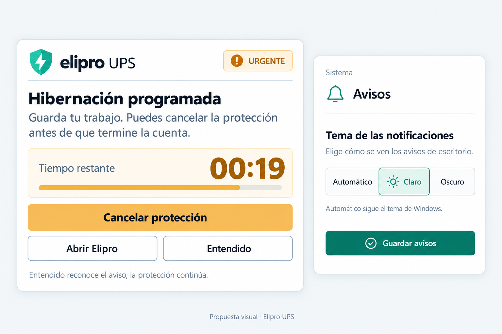
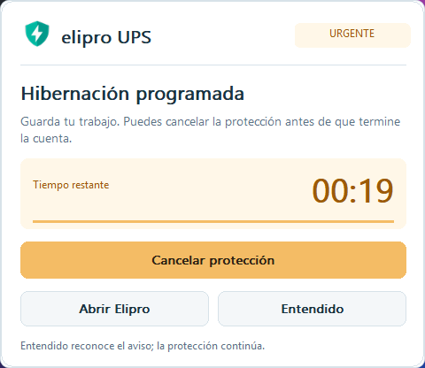
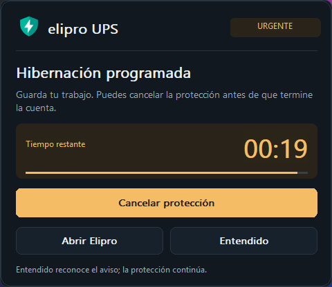
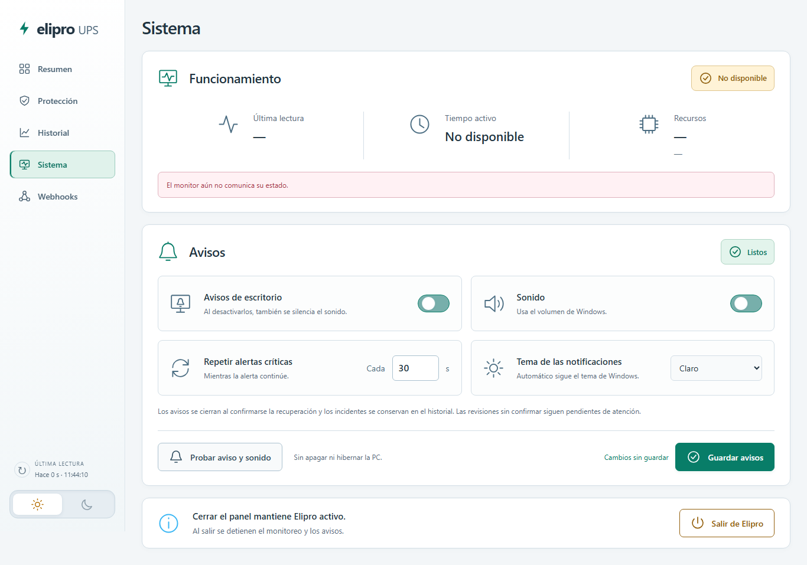

# Plan de implementación: notificaciones de Elipro 0.9.22

Fecha: 25 de octubre de 2026, hora de Lima.

Estado: implementación y validación local completadas para 0.9.22. La imagen siguiente es la propuesta aprobada; las capturas nativas verificadas se incluyen al final.

## Resultado previsto

La ventana de escritorio utiliza el logo oficial de Elipro, un fondo uniforme, colores de marca, una jerarquía clara entre título y descripción, y una cuenta atrás separada del título. Durante una cuenta vigente, **Cancelar protección** tiene mayor presencia que **Abrir Elipro** y **Entendido**. Las dimensiones y la distribución deben permitir leer mensajes largos y funcionar con la escala de Windows.

**Sistema → Avisos → Tema de las notificaciones** ofrece **Automático**, **Claro** y **Oscuro**. El valor inicial es Automático y sigue el tema de las aplicaciones de Windows. Esta preferencia afecta las ventanas de escritorio de Elipro y se guarda con los demás ajustes de avisos. El selector claro/oscuro del panel conserva su función propia. En un escritorio disponible, tanto los avisos persistentes como los transitorios y **Probar aviso y sonido** usan el diseño de Elipro. En estados restringidos, como pantalla completa o silencio, se conserva la política de entrega de Windows; los globos que administra el sistema no se personalizan.

## Pasos de implementación

1. **Preferencia y persistencia.** Añadir `theme` con valores admitidos `auto`, `light` y `dark` a la configuración de avisos, validar entradas y completar las configuraciones anteriores con `auto`. Recuperar el valor guardado al iniciar y aplicarlo al guardar nuevos ajustes.
2. **Interfaz de configuración.** Incluir el selector y la ayuda «Automático sigue el tema de Windows.» en Sistema → Avisos. Conservar los cambios del formulario mientras llega el sondeo de estado y mantener el guardado explícito junto con las demás opciones.
3. **Entrega al escritorio.** Transmitir el tema desde el monitor del servicio al agente de cada sesión. Aplicarlo antes de presentar avisos y actualizar las ventanas existentes mediante el hilo de interfaz, sin bloquear la lectura del UPS ni esperar llamadas del navegador.
4. **Ventana nativa de marca.** Reutilizar el icono incluido en el paquete y dibujar superficies, textos, contador y acciones con paletas clara y oscura coherentes con Elipro. Mantener foco visible, etiquetas comprensibles y acciones disponibles por teclado. Escalar tipografías, controles y márgenes con DPI; mantener la ventana dentro del área de trabajo del monitor y responder a cambios de tema y escala.
5. **Regresiones y revisión visual.** Verificar configuración, transporte, prioridad, acuse, cancelación, caducidad, sonido y recursos nativos con dependencias simuladas. Comprobar visualmente los temas y distintas escalas sin iniciar el monitor real ni ejecutar acciones de energía.
6. **Entrega.** Actualizar la versión a `0.9.22`, documentar las comprobaciones efectivamente realizadas, crear el commit y enviar a `main`. La compilación del instalador se realiza mediante el flujo de Windows del repositorio. El usuario instalará la nueva versión manualmente.

## Comportamiento que debe conservarse

- **Entendido** reconoce exclusivamente el aviso presentado. No cancela la cuenta atrás, no cambia políticas y no envía órdenes de energía.
- **Cancelar protección** solicita la cancelación de la cuenta vigente al monitor. Solo se habilita con identificador actual, datos recientes y permiso de cancelación; el éxito necesita confirmación del monitor. Mientras se confirma, el botón permanece deshabilitado y muestra su estado.
- **Abrir Elipro** abre el panel y conserva la actuación pendiente.
- Llegar a cero o perder confirmación no demuestra que Windows haya hibernado o que el UPS se haya apagado. Debe mostrarse el estado sin confirmar y bloquear la cancelación caducada.
- Las cuentas reales conservan prioridad sobre alarmas críticas; estas siguen antes que los cortes y revisiones pendientes. Reconocer un incidente no reconoce otro que llegue después.
- La recuperación confirmada conserva el cierre automático aplicable y los incidentes siguen en el historial. Cambiar de tema no reconoce avisos ni modifica su vigencia.
- El contador y el repintado no repiten el sonido. Los intervalos de repetición, el silencio configurado y el bloqueo o desconexión de sesión mantienen sus comprobaciones.
- Los recursos gráficos, fuentes e iconos se reutilizan y se liberan al cerrar la ventana. El diseño no añade un navegador ni dependencias de interfaz externas al agente.

## Criterios de aceptación

| Área | Comprobación requerida |
| --- | --- |
| Tema guardado | Claro, Oscuro y Automático sobreviven al reinicio; configuraciones anteriores cargan Automático. Las entradas desconocidas se rechazan. |
| Sesión de servicio | La preferencia llega al agente y se aplica antes del aviso, incluso al reconectar. |
| Formulario | El sondeo no sobrescribe una selección sin guardar. Guardar y recargar recuperan la opción elegida. |
| Presentación | Logo correcto, fondo uniforme, contador legible, acciones diferenciadas y mensajes sin recortes evitables en ambas paletas. |
| Windows | Escala DPI, cambio de monitor, cambio del tema automático y cierre de recursos sin errores. |
| Protección | Acuse separado de cancelación, prioridad estable, cuenta caducada no cancelable, ningún éxito inferido al llegar a cero. |
| Aislamiento | Pruebas con relojes, transporte, ventanas, USB y acciones de Windows simulados. No provocar cortes ni hibernaciones para verificar el diseño. |

## Validación y distribución

Resultados locales del 25 de octubre de 2026:

- Suite completa Python: **1014 pruebas aprobadas**, con dependencias de USB y acciones de energía simuladas. Tras el último ajuste de distribución en áreas pequeñas: **99 pruebas dirigidas aprobadas**.
- Interfaz: **181 pruebas aprobadas**, incluyendo tema guardado, borradores durante sondeo, pérdida de conexión y compatibilidad con monitores anteriores.
- Ventanas nativas reales: capturas de Claro y Oscuro a **96, 144 y 192 DPI** (100 %, 150 % y 200 %), con tipografía Segoe UI y sin errores de presentación registrados. También se verificó la cuenta caducada con contador sin confirmar y cancelación deshabilitada. El programa de captura crea únicamente ventanas de prueba; no inicia el monitor y omite el registro en la bandeja del escritorio aislado.
- Panel real en Edge headless con respuestas locales simuladas: **1366, 1920 y 320 píxeles**, selector visible y sin desbordamiento horizontal ni errores JavaScript. La captura del panel usa datos simulados y no describe el estado del servicio instalado.
- Pruebas dirigidas de alto contraste, asignaciones fallidas y liberación de fuentes, pinceles e iconos, ausencia de sonidos o ventanas duplicados, mantenimiento del episodio al cambiar tema y acciones dentro de un área lógica de **240 × 280**. En áreas tan pequeñas, la presentación compacta prioriza título, reloj y acciones; los detalles completos se consultan en el panel.
- `git diff --check` sin incidencias. Evidencia local ampliada: `.test-data/notification-redesign/`.
- La primera ejecución en GitHub detectó una comparación de metadatos de vigencia dependiente del reloj real en la prueba de autorización del acuse. Se fijó el reloj de esa fixture para que compare snapshots deterministas; la corrección afecta exclusivamente a la prueba.

Tras el push a `main`, el flujo **Windows x64 installer** ejecuta de nuevo las suites, empaqueta el ejecutable y valida el instalador con un servicio simulado y acciones de energía bloqueadas. Su resultado y el artefacto de esa revisión se consultan en GitHub Actions. La instalación en el equipo del usuario queda a su cargo; esta entrega no ejecuta el instalador ni modifica el servicio instalado. Los resultados físicos anteriores conservan su alcance y no acreditan nuevas pruebas de energía.
